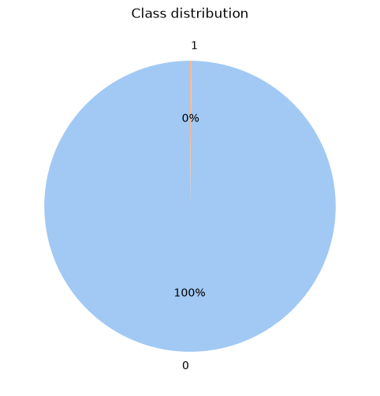
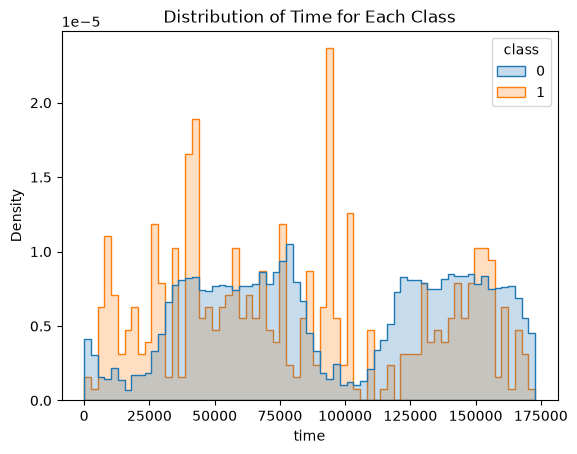
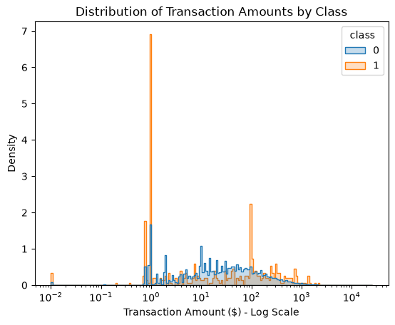
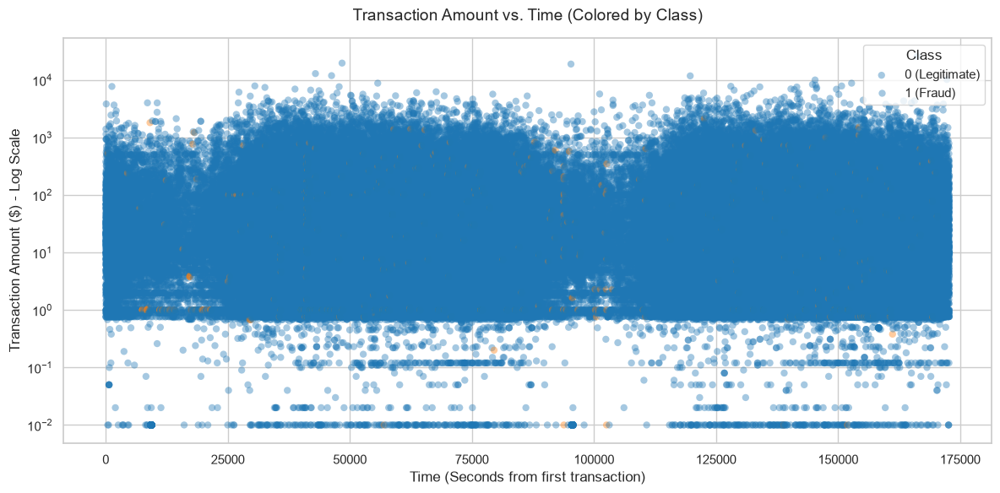
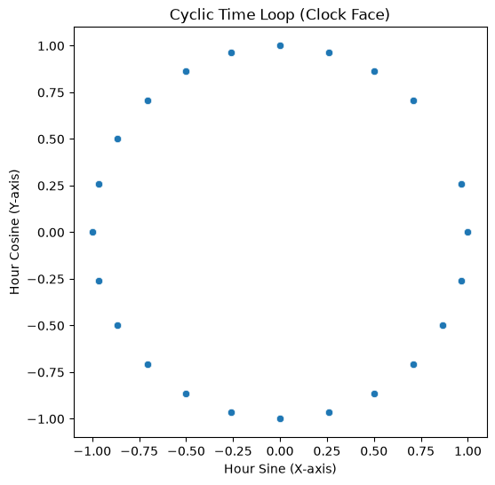
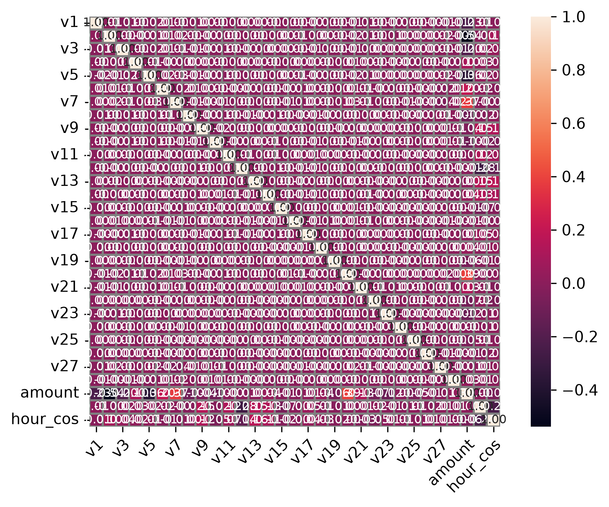
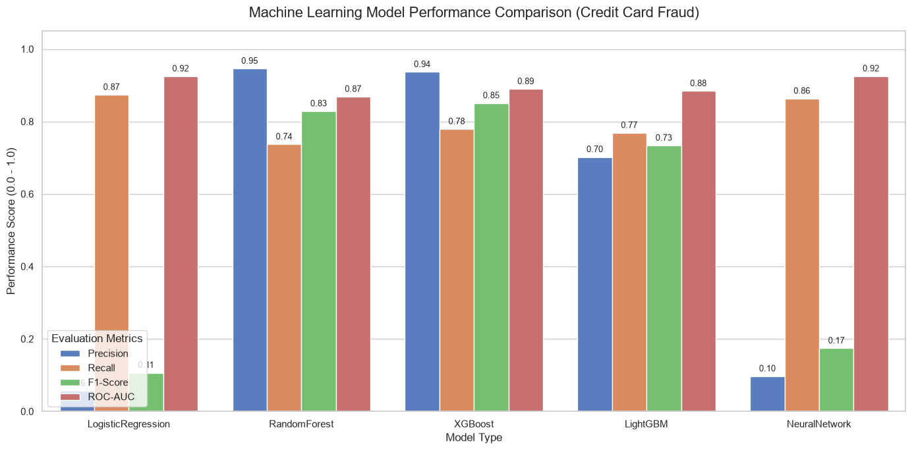
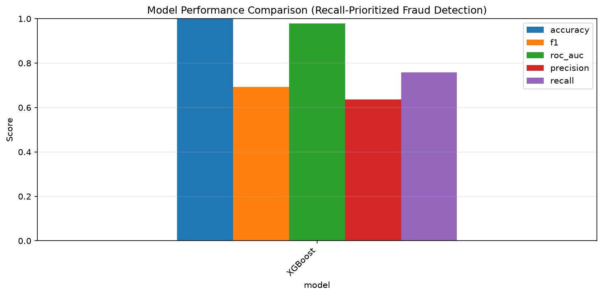
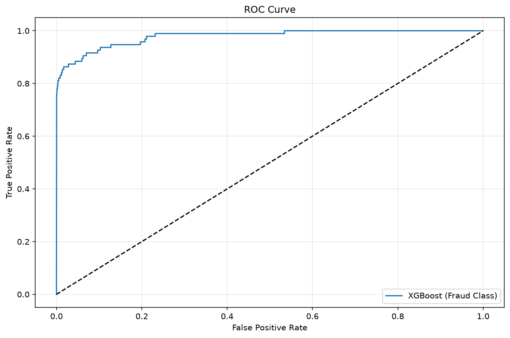
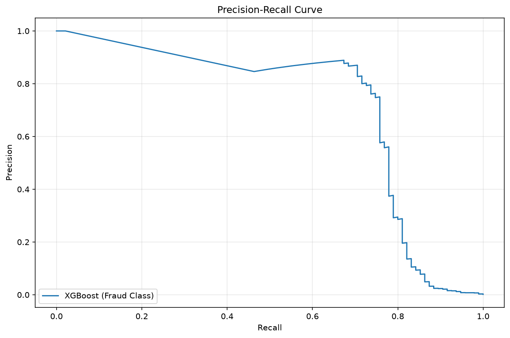

## Credit Card Fraud Detection ML System

This repository hosts a robust machine learning system engineered to analyze financial transaction datasets, handle severe class imbalance, and accurately predict fraudulent credit card transactions in real time.

Dataset: https://www.kaggle.com/datasets/miadul/credit-card-fraud-detection-dataset

---

## Business objective & strategic value

The primary goal of this predictive intelligence platform is to safeguard financial institutions and cardholders by detecting fraudulent transactions rapidly while minimizing false positives that disrupt legitimate customer experiences.

### Key business driver alignment:

* **Real-time fraud triage:** By predicting whether incoming transaction payloads indicate fraudulent activity (`Class`), payment gateways can automatically flag, hold, or block high-risk transactions instantly.
* **Minimizing financial losses:** Proactively intercepting fraudulent charges reduces chargeback overhead, direct fraud losses, and merchant liability.
* **Reducing false positives:** Precision-Recall tuning and advanced tree-based classifiers ensure legitimate customer transactions are not unnecessarily declined, preserving customer trust and revenue.
* **Data-driven risk monitoring:** Tracking feature drift and statistical shifts via automated monitoring endpoints empowers risk operations teams to adapt models against evolving fraud patterns.

---

## Project architecture & directory structure

```text
credit-card-fraud-ml/
│
├── api/
│   ├── controller/
│   │   └── retrain.py          # Tracks automated data drift & retraining execution
│   ├── database/
│   │   ├── database.py         # SQLite authentication management
│   │   └── schema.py           # Transaction payload schema validations
│   ├── middleware/
│   │   ├── auth.py             # JWT bearer validation & worker rate-limiting
│   │   └── train.py            # Async application train hooks & context locking
│   └── api.py                  # Core ASGI FastAPI routing layer
│
├── data/
│   └── raw/                    # Base training records
│
├── models/
│   ├── models/                 # Saved machine learning estimator (.pkl) models
│   ├── pipelines/              # Serialized configuration pipelines
│   └── scalers/                # Extracted feature standardizers (e.g., Amount & Time normalization)
│
├── src/
│   └── v1/
│       ├── config.py           # Tuning distributions & configuration attributes
│       ├── evaluate.py         # ROC/PR evaluation metrics engine
│       ├── explain.py          # SHAP computation logic for fraud drivers
│       ├── main.py             # Main pipeline orchestrator
│       ├── monitor.py          # Data drift and statistical calculation layer
│       └── preprocessing.py    # Imbalance handling, feature engineering & scaling
│
├── plots/                      # Visualizations (EDA, evaluation, and SHAP explainability)
│   ├── features/               # Class distribution, time/amount plots, and correlation matrices
│   ├── evaluate/               # Model comparison, ROC, PR curves, and performance metrics
│   └── shap/                   # XGBoost SHAP importance and dependency plots
│
├── class_0_test.json           # Use this to test class 0 dataset
├── class_1_test.json           # Use this to test class 1 dataset
├── Dockerfile                  # Orchestration file
├── README.md                   # Documentation about this project
├── pyproject.toml              # Project configuration profile
└── requirements.txt            # System dependencies manifest

```

---

## Feature engineering & exploratory data analysis

### Key transaction features & distributions

The dataset exhibits classic financial fraud characteristics, notably extreme class imbalance between legitimate and fraudulent transactions, alongside continuous numerical features (`Time`, `Amount`, and anonymized PCA components `V1` through `V28`).

#### Some important plots



From the pie-chart, it is pretty clear, we are working with extremely imbalanced dataset. Fraud class is less than 1%. It will be handled appropriately in production.



From the plot above, time seems like time elapsed from transaction (roughly 2 days). the legitimate transactions are smooth-ish curve. whereas, the fraud cases has spikes and not smooth at all.

Both of them seem to be dropping between 75,000 and 125,000 seconds which makes sense, since it is midnight (roughly 1 to 6 am). But at the same time, the plot makes it clear if transaction are happening in the middle of the night, it is most likely a fraud one.



We again see the same kind of smoothness and scatterness of amount from legitimate and fraud cases respectively. Legitimate transactions are pretty smooth. whereas the fraud cases are spiky and has lack of smoothness.

At 10^0 or 1, there seem to be huge spike of both legitimate and fraud transactions. Of course, fraud transactions are way more than the legitimate ones. which slightly makes sense. Fraudsters mainly check if credit card is working or not by taking out or transacting 1 $.

At 10^2 or 100 there seems to be another spike in transaction, which seems to imply that fraudsters target clean number like 100.

And fraud cases are seem to be hovering more around 10^3 or 1000, which seems to indicate that fraudsters take out higher amount transactions, after checking if the card works or not.



Above plot shows the relationship between time elapsed and transaction amount. This plots shows complete 2 valleys (24 hour time). Peak at 50,000 and 150,000 which makes sense since they are middle of the day.

Plot also makes it clear that fraud or legitimate transaction happens nearly every hour. But at the same time, there seem to be slight concerntration of fraudulant transaction around middle of the night (around 2 3 am). Which could make sense, banks are not opened at that time, so it would take people time to realise and thus report the frauds.

And micro transactions seem to be happening alot (around 10^-2 or 0.01), which could be fraudsters testing if the card works or not.

### Engineered features

* `eng_hour_sin_and_cos`: Cyclic sine and cosine transformations of transaction timestamps to capture periodicity in fraud patterns across hours of the day.



#### Correlation analysis & feature selection



Correlation heatmaps confirm linear independence among most principal components, while highlighting specific interaction patterns between transaction amounts and temporal features. Features are pruned based on multicollinearity thresholds and SHAP-derived feature attribution.

---

## Model evaluation & performance metrics

Multiple classification algorithms (XGBoost, LightGBM, Random Forest, and Neural Networks) were benchmarked to maximize Precision-Recall AUC (PR-AUC) and minimize false negatives.



Looking at the metrics XGBoost seem to offer good balance between precision and recall. It has precision of 93.6% and at the same time 77.89% recall. It seems to offer good precision-recall tradeoff balance.

Looking at the metrics, Random forest and to certain extent LightGBM also offer similar model performance. Especially random forest, its performance is highly comparable to that of XGBoost. But in this dataset, XGBoost seem to have slight edge over it. Of course, more hyperparameter tuning may be able to change that fact.

Whereas, neural network and logistic regression are two worst models. For neural network, it could be because it is too shallow (for testing deeper network it will require bigger processing power which i lack at the moment). And it may not make sense to use neural network even if it were performing the best because of the operating cost of such models. Businesses may be able to absorb lower performance for higher saving of costs.

And as for logisticregression, well, it did not converge in max_iter=1000. If it did converge its performance could have been better but it didn't really make sense for me to do that, since we already have model that performs better and is able to learn more complex relationship between different variables (XGBoost).

Fallacy of roc: if we look at the roc, they (NN and LR) are the best performing model, but since this is highly unequal distribution datasest, it is misleading.

So, for production XGBoost will be used. Its higher f1-score makes it ideal for minimizing cost of investigating and at the same time, saving their time.

Of course, in real business setting the RandomForestClassifier could be used, if it requires less processing power i.e. less operating expenses. Businesses may be able to swallow lower score for lower costs. and of course, it also comes at the cost of maintaining investigative team.

So, in real business setting, ml engineer can and should make business case for either of the model by taking operating costs, both servers and HR, into account.


### Model in production - XGBoost



**NOTE:** I had to do huge Precision recall tradeoff. I was able to get recall of above 0.8 but it came at serious cost to recall.

Current hyperparameter as well as decision threshold presents, in my humble opinion, good tradeoff between precision and recall.

Currently, recall is at 0.758, precision is at 0.64 and f1 at 0.69. It provides good tradeoff with lower operating costs. Happy customer and less time taken by our investigating team.

Of course, plots also shows around early 0.70s the precision takes a huge fall so, technically recall could have been that threshold. But to priotised finding out if the transaction is legitimate or fraud, I choose higher recall. Of course, it could have been selected at that huge drop point to figure out the new optimal precision and recall. But, I choose 0.75.





Looking at the plots, it should be clear why I choose around 0.70s. Around that recall the precision was pretty high, well, high-enough for this project.

**NOTE:** Check the plots/evaluate/v1/ for more plots and tradeoffs i have made in this project.

---

## SHAP metrics & model explainability

To ensure transparency and compliance in financial risk scoring, SHAP (SHapley Additive exPlanations) values are computed for every inference batch.


From the plots above, it seems like I could have removed the next 17 metrics. But, for simplicity I didin't. In actual production, to lower the server costs, they could be removed.

V14, v4, v10, v12, v11, and v3 (to an extent) seems to be the most important feature, as to what they and why well, I don't know since it is PCA output rather than raw dataset, it is not clear what they are.

---

## Quick start

### 1. Environment setup - Using requirements.txt

```bash
# Clone the repository
git clone https://github.com/officialroshanshahi/credit-card-fraud-ml.git
cd credit-card-fraud-ml

# Create and activate a Python virtual environment
python -m venv venv
source venv/bin/activate  # On Windows: venv\Scripts\activate

# Install dependencies
pip install -r requirements.txt

# Add .env configuration
# Copy the template from src/experiments/.env to the root folder and configure your settings.

```

### 1.2 Environment setup - Using pyproject.toml

```bash
# Clone the repository
git clone https://github.com/officialroshanshahi/credit-card-fraud-ml.git
cd credit-card-fraud-ml

# Create and activate a Python virtual environment
python -m venv venv
source venv/bin/activate  # On Windows: venv\Scripts\activate

# Install the project and its dependencies using pyproject.toml
pip install .

# Add .env configuration
# Copy the template from src/experiments/.env to the root folder and configure your settings.

```

### 1.3 As the dataset exceeded the file size limit of github, I have compressed the dataset so please uncompress the file in data/raw/creditcard.rar into data/raw/creditcard.csv

### 2. Launch the FastAPI server

Launch the backend inference engine:

```bash
python -m api.uvicorn_init

```

### 3. Launch the Interactive Gradio Interface

Launch the web dashboard for single or batch transaction scoring:

```bash
python -m app.gradio

```
---

## Quick start - Lauching both api and gradio together side by side in VS code:

### 1. Go to src/experiments
### 2. Copy the tasks.json
### 3. Put that file in .vscode
### 4. Press CTRL + SHIFT + P
### 5. Click on Tasks: Run Task
### 6. Select Full-stack Credit Card Fraud ML model

### Of course, make sure use your virtual environment, and install necessary modules first before doing this.
#### I have compressed the dataset so please uncompress the file in data/raw/creditcard.rar into data/raw/creditcard.csv
---

## Model lifecycle & MLOps practices

1. **Preprocessing (`src/v1/preprocessing.py`)**: Handles class imbalance resampling, missing value imputation, and feature scaling.
2. **Training & Evaluation (`src/v1/train.py`, `src/v1/evaluate.py`)**: Executes cross-validation, evaluates Precision-Recall AUC and ROC metrics, and serializes production model artifacts.
3. **Explainability (`src/v1/explain.py`)**: Computes SHAP summary and waterfall plots to explain individual transaction risk scores to fraud analysts.
4. **Monitoring & Drift (`src/v1/monitor.py`)**: Tracks feature distributions between training baselines and incoming live inference streams, generating HTML monitoring reports via the `/monitor` endpoint.